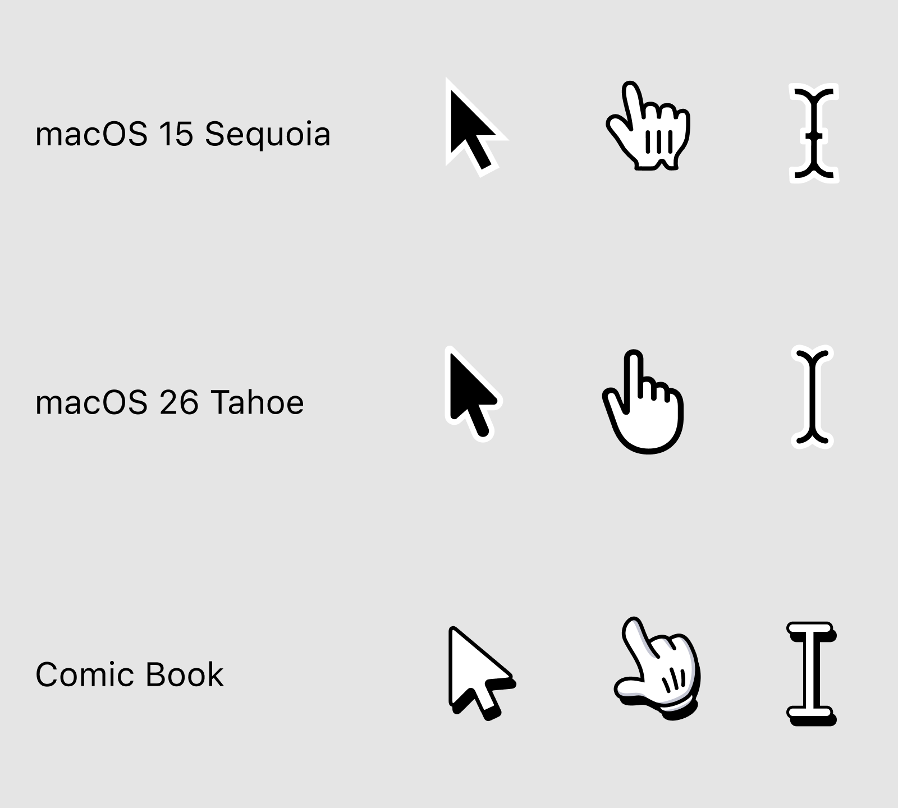

# Big bold beautiful comic book-style cursors for macOS



Motivation:

- Larger, easier to see.
- Better arrow proportions.
- Perfectly symmetrical.
- Angled pointer hand—less striking change on hover.

Download from releases: [ComicBook_cape.zip](https://github.com/tonsky/macos-cursors-comic-book/releases/latest/download/ComicBook_cape.zip), or grab [ComicBook.cape](./ComicBook.cape) from this repo.

To be used with [Mousecape](https://github.com/alexzielenski/Mousecape). For Tahoe/Golden Gate, [Mousecape-swiftUI](https://github.com/sdmj76/Mousecape-swiftUI) worked for me.

## Applying without Mousecape

Alternatively, if you want something minimal, a LaunchAgent in [launchagent/](./launchagent) applies the cursors at login and re-applies them after display changes. It needs Xcode Command Line Tools (`xcode-select --install`) to compile a tiny helper, `capeapply`.

Install:

```sh
git clone https://github.com/tonsky/macos-cursors-comic-book.git
cd macos-cursors-comic-book/launchagent
./install.sh
```

This builds `capeapply`, copies it together with [ComicBook.cape](./ComicBook.cape) into `~/Library/Application Support/ComicBookCursors/`, installs `~/Library/LaunchAgents/me.tonsky.cursors.plist` and starts it. Cursors change immediately. Pass a path to use a different cape: `./install.sh path/to/file.cape`.

Uninstall:

```sh
./uninstall.sh
```

then log out and back in to get stock cursors back.

`capeapply` by [kgoh](https://github.com/KGOH).